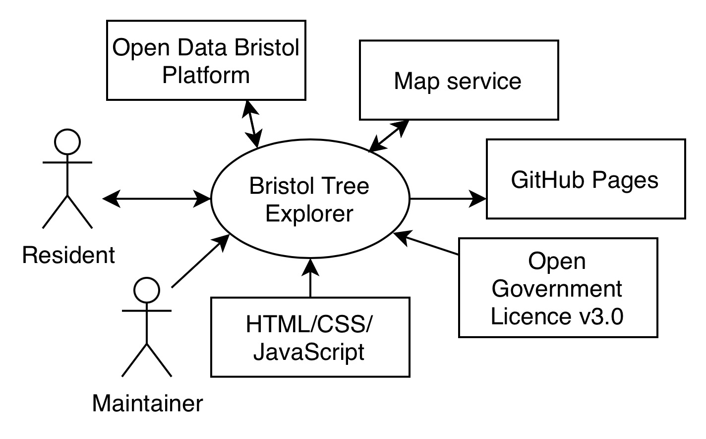

# Project Proposal
## Business Case

### Problem statement
Bristol City Council has published 56,550 tree records as open data. However, the data is stored in a technical format (raw JSON), making it difficult for non-technical users to access and understand. Each request is limited to 1,000 records, preventing users from retrieving the entire dataset at once. Important details, such as tree size, are stored in inconsistently formatted text, with typos and unclear values, making comparisons difficult. As a result, residents without a technical background may struggle to explore and discover Bristol's notable trees, particularly those with the widest trunks.

### Business benefits
-	The project makes council data easier to access and explore, especially for residents without a technical background.
-	It encourages people to visit local green spaces and discover important landmark trees within their communities.
-	It also demonstrates the value of open data by making information more engaging and useful, with potential applications in education and community awareness.
-	The project is cost-effective because it uses free and publicly available existing open data, reducing the need for additional resources or expensive data collection.
-	The app helps users discover the city's biggest trees by highlighting those with the widest trunks.

### Options Considered
-	_Treezilla_: A UK-wide tree-mapping platform that allows users to locate, measure and contribute tree records. Its main focus is citizen science and mapping trees across the UK. 
-	_Trees of Bristol_: An interactive website that allows users to explore Bristol's trees by location, species and collection. 
-	_Bristol Tree Explorer (my project)_: Provides a simpler way to explore Bristol City Council's open tree data, focusing specifically on filtering and comparing trees by trunk width.

### Expected Risks
-	API unavailable: The application may fail to retrieve data if the council's API is down. I will display an error message and allow users to retry.
-	1,000-record limit: The API limits each request to 1,000 records. I will use filters to retrieve only the trees needed, such as those with the widest trunks.
-	Messy or missing data: Inconsistent or missing values may affect results. I will display "Not recorded" instead of unclear raw values.
-	Missing tree age: The dataset does not include tree ages. I will explain that trunk width can provide a rough indication of a tree's age, but cannot determine its exact age.
-	Incomplete dataset: The dataset does not include woodland trees or trees on council land that are not managed by the council's tree officers. I will clarify that the app only reflects the available data.

## Project Scope
### In Scope
- Bristol Tree Explorer: Web application for discovering Bristol's biggest trees.
- Resident: User who explores tree information.
- Maintainer: Person responsible for maintaining the application.
- Open Data Bristol Platform: Provides the council's tree dataset.
- Map service: Supplies the map that tree locations are shown on.
- GitHub Pages: Hosts the web application.
- Open Government Licence v3.0: Allows reuse of the open data with attribution.
- HTML/CSS/JavaScript: Technologies used to build the application.

### Out of Scope
- User accounts.
- Editing council data.
- Providing real tree ages.

